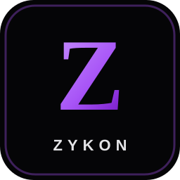
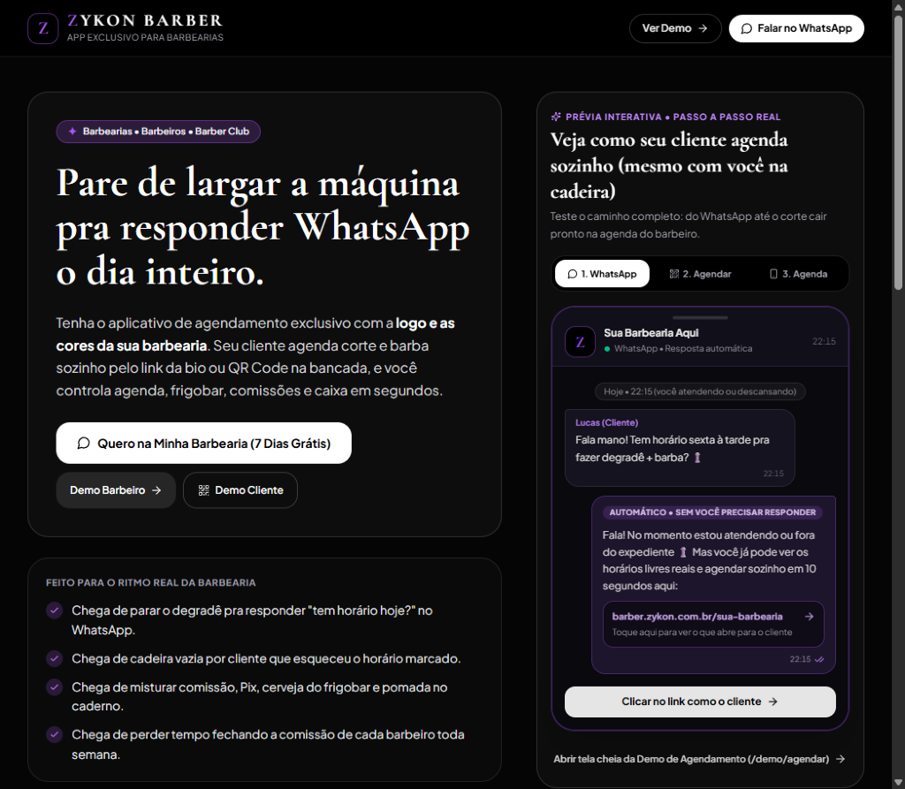
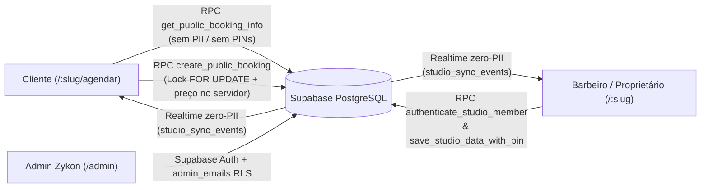

# ✦ ZYKON BARBER

**Plataforma SaaS Mobile-First (PWA) White-Label para Barbearias**

[-18181B?style=for-the-badge)](#sobre-este-repositório)

---

> **Sobre este repositório:** O código-fonte completo do **Zykon Barber** é mantido em repositório privado por se tratar de um produto SaaS comercial em produção pela **[Zykon](https://zykon.com.br)**. Este repositório atua como **Showcase técnico e comercial**, apresentando a arquitetura, decisões de segurança, experiência visual e funcionalidades do sistema.

---

## Prévia da Interface

  

- **Vitrine & Simulador Interativo (3 passos):** [`barber.zykon.com.br`](https://barber.zykon.com.br)
- **Demo do Painel da Barbearia (PINs `0000`, `1111`, `2222`):** [`barber.zykon.com.br/demo`](https://barber.zykon.com.br/demo)
- **Demo de Autoagendamento Público (Cliente):** [`barber.zykon.com.br/demo/agendar`](https://barber.zykon.com.br/demo/agendar)

---

## O Problema que o Zykon Barber Resolve

Barbearias perdem faturamento e foco todos os dias interrompendo atendimentos na cadeira para responder *"tem horário hoje?"* no WhatsApp, sofrendo com furos na agenda e fechando comissões e consumo de frigobar no papel.

O **Zykon Barber** entrega para cada barbearia um **aplicativo PWA exclusivo com sua própria marca, logo e paleta de cores**, pronto para ser instalado no iPhone e Android em 1 minuto — sem depender de lojas de aplicativo.

---

## Principais Funcionalidades

| Módulo | O que entrega na operação |
| :--- | :--- |
| **Autoagendamento Público 24h (`/:slug/agendar`)** | O cliente acessa pelo link da bio, resposta automática do WhatsApp ou QR Code na bancada, escolhe serviço, barbeiro, dia aberto e horário livre real, e envia o comprovante direto no WhatsApp da barbearia. |
| **Gerador de Arte de Bancada 10×15 cm** | Modal integrado que renderiza em **Canvas HTML5 (1200×1800 px / 300 DPI)** uma arte personalizada com o nome da barbearia e QR Code, pronta para imprimir e colocar em display de acrílico. |
| **Agenda Inteligente & Dias Abertos** | Calendário semanal e mensal com detecção de conflitos **por barbeiro**, exceções individuais de feriados/plantões e integração com **Google Agenda** (envio 1-toque, exportação `.ics` e OAuth 2.0). |
| **Fechamento, Comissões & Frigobar/Mercado** | Fechamento assistido confirmando serviços realizados, consumo de itens (cerveja long neck, água, refrigerante, pomada modeladora, óleo para barba) com baixa automática de estoque e cálculo automático de **comissão por barbeiro e por serviço**. |
| **Dashboard Financeiro & Planilha CSV** | Visão separada por nível de acesso (PIN de 4 dígitos): o **Proprietário** vê faturamento bruto, comissões, líquido da barbearia, formas de pagamento e comparativo por barbeiro; cada **Barbeiro** vê seu painel individual. Exportação pronta em `.csv` (Excel/Sheets). |
| **Painel Admin Multi-Tenant (`/admin`)** | Protegido por **Supabase Auth**, permite criar barbearias white-label em 1 minuto, gerenciar paletas, módulos, status (`ativo` / `trial` / `suspenso`), atalhos de validade (`+7d Trial`, `+30d Mensal`, `+90d Trim.`) e acompanhar o MRR. |

---

## Sistema White-Label (5 Paletas de Barbearia)

O tema é injetado dinamicamente via CSS Custom Properties (`--zk-bg`, `--zk-surface`, `--zk-text`, `--zk-muted`, `--zk-border`, `--zk-accent`, `--zk-accent-text`), preservando a estética **Dark Luxury Editorial** da Zykon:

| Paleta | Estilo | Fundo | Superfície | Destaque |
| :--- | :--- | :---: | :---: | :---: |
| **Obsidian** | Preto & Branco | `#000000` | `#0E0E0E` | `#FFFFFF` |
| **Ouro Barber** | Preto & Dourado | `#070604` | `#14110C` | `#D6B36A` |
| **Whiskey & Couro** | Café & Âmbar | `#110C08` | `#1E1510` | `#F59E0B` |
| **Club Esmeralda** | Verde Musgo & Creme | `#050C09` | `#0D1914` | `#34D399` |
| **Navalha Clássica** | Grafite & Vermelho | `#09090B` | `#141418` | `#EF4444` |

---

## Arquitetura & Segurança

O projeto adota arquitetura **multi-tenant por slug** com blindagem em nível de banco de dados no **PostgreSQL / Supabase**:

### Decisões de Segurança Aplicadas
- **Zero exposição de dados operacionais para `anon`:** a tabela `studio_data` tem acesso direto bloqueado para usuários anônimos via **Row Level Security (RLS)**.
- **Autoagendamento público sanitizado e atômico:** o cliente recebe apenas serviços, nomes dos barbeiros e janelas ocupadas; a reserva executa dentro de uma função `SECURITY DEFINER` com lock de linha (`FOR UPDATE`), impedindo agendamentos duplicados, *race conditions* e adulteração de preços.
- **Autenticação por PIN no servidor + isolamento de privilégios:** o PIN é validado no PostgreSQL; para barbeiros (`staff`), o servidor mascara os PINs dos demais membros e impede alteração em equipe, comissões, serviços ou configurações da barbearia.
- **Realtime sem vazamento de PII:** a sincronização instantânea entre celulares usa uma tabela leve de sinalização (`studio_sync_events` contendo apenas `version` e `updated_at`), disparando recargas autenticadas sem trafegar dados pessoais no canal público.
- **Admin restrito por lista de autorização (`admin_emails`):** apenas e-mails explicitamente autorizados no banco possuem permissão de escrita em `studios`.
- **Hardening HTTP na borda (Vercel):** cabeçalhos `X-Content-Type-Options: nosniff`, `X-Frame-Options: DENY`, `Referrer-Policy` e `Permissions-Policy`.

---

## Stack Tecnológica

- **Frontend:** React 19, TypeScript 5.8, Vite 6, Tailwind CSS v4
- **UI & Utilitários:** Lucide React, QRCode, HTML5 Canvas (Arte 10×15 cm), Google Fonts (`Cormorant Garamond` + `Plus Jakarta Sans`)
- **Backend & Banco:** Supabase (PostgreSQL, Row Level Security, PL/pgSQL RPCs `SECURITY DEFINER`, Supabase Auth, Realtime)
- **Integrações:** WhatsApp Deep Links, Google Identity Services & Google Calendar API v3, exportação `.ics` e `.csv`
- **Infraestrutura:** Vercel (Edge + SPA Rewrites + Security Headers) & PWA (`manifest.webmanifest`)

---

## Contato Comercial — Zykon

Interessado em testar o **Zykon Barber** com a marca da sua barbearia ou conhecer outras soluções do ecossistema Zykon?

- **Site:** [zykon.com.br](https://zykon.com.br)
- **WhatsApp:** [(62) 98191-9282](https://wa.me/5562981919282)
- **E-mail:** [contato@zykon.com.br](mailto:contato@zykon.com.br)

---

  ✦ <strong>Desenvolvido por Zykon</strong>

